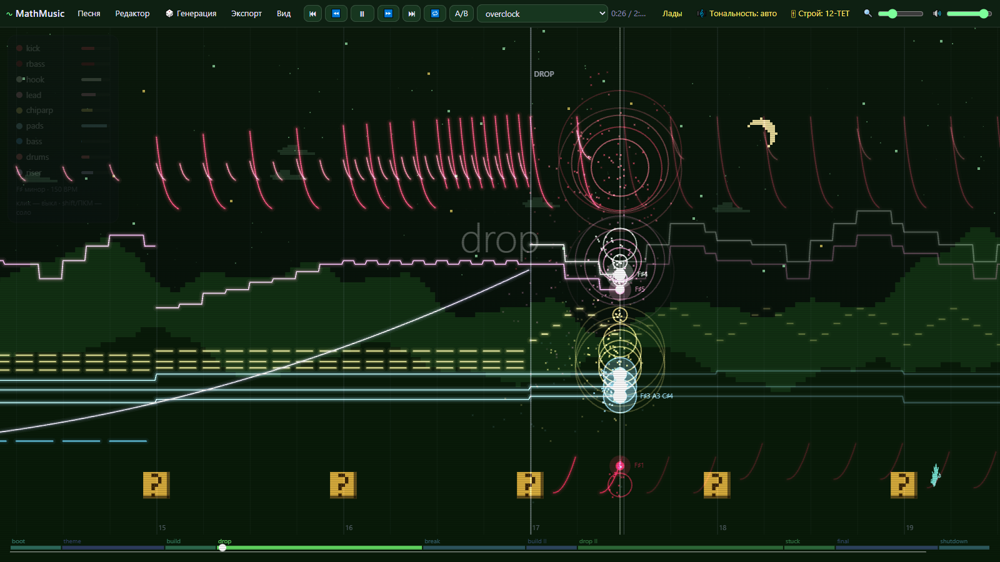
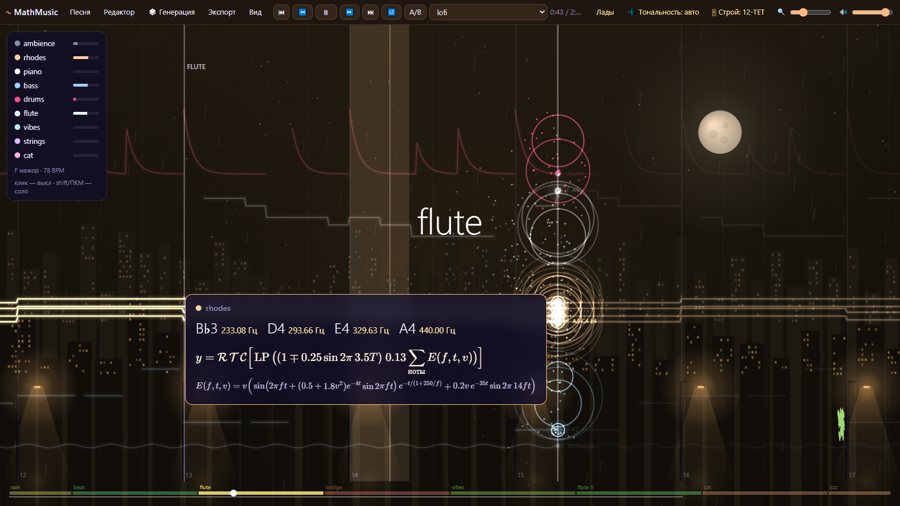
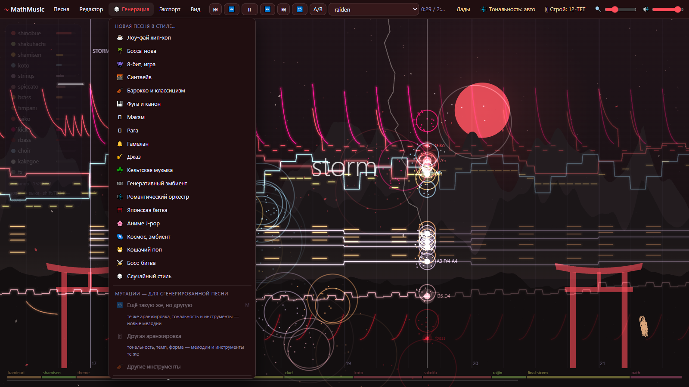
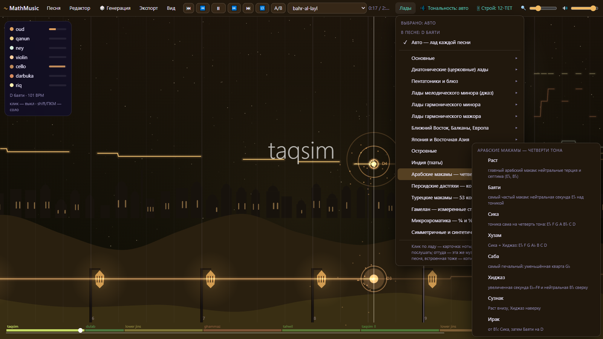
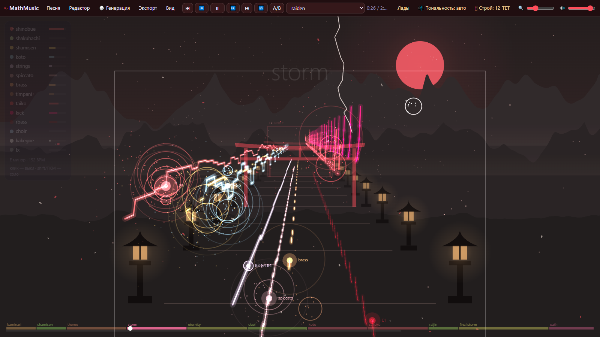
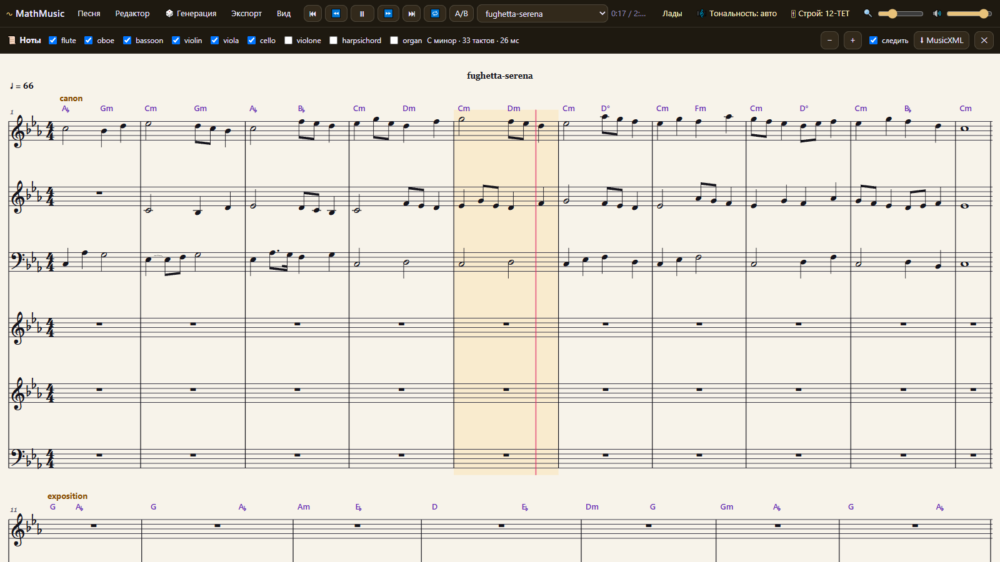
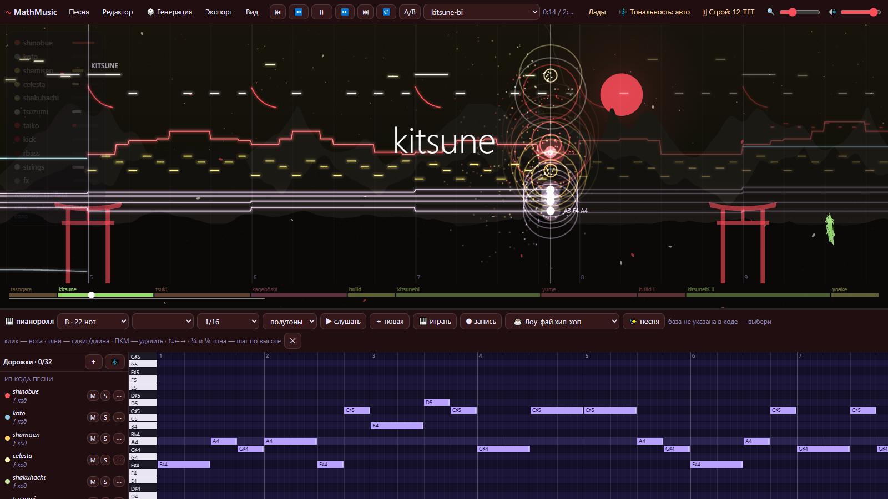
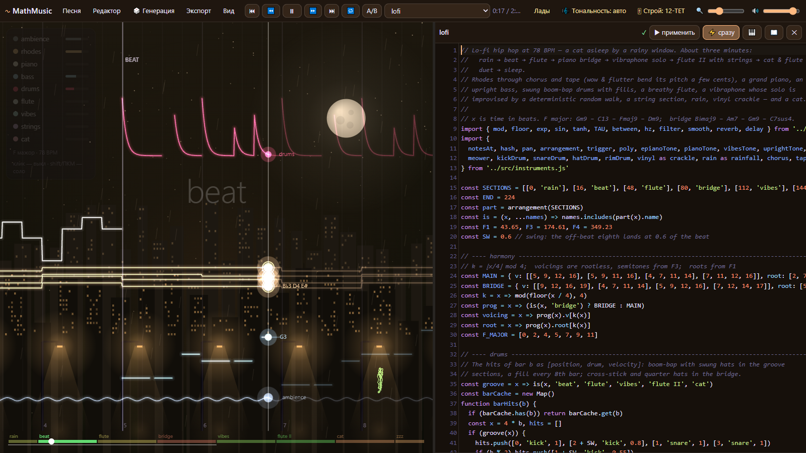
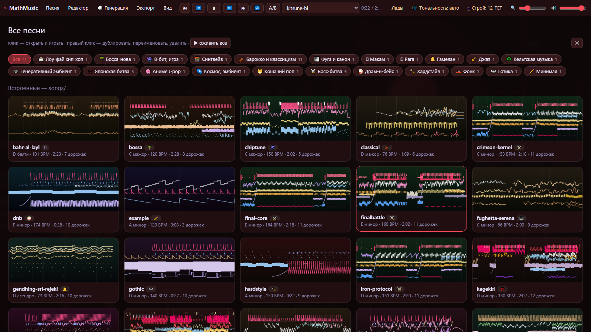

<div align="center">

# 〜 MathMusic

### Музыка, которая целиком состоит из математики

**Ни одного сэмпла, ни одного готового синтезатора: каждый звук здесь — формула.**

[**⬇ Скачать для Windows**](https://github.com/astramix/mathmusic/releases/latest) · [Руководство (PDF)](docs/MathMusic%20—%20руководство.pdf) · [astramixofficial@gmail.com](mailto:astramixofficial@gmail.com)



</div>

## ∑ Не движок, а алгебра

MathMusic — это **не** обычный аудиодвижок с банком сэмплов и готовыми плагинами. Каждая песня — набор
**функций от времени x**, и всё, что вы слышите, вычисляется из них отсчёт за отсчётом, 44 100 раз в секунду:

- **бочка** — синус, частота которого экспоненциально падает:  y = e<sup>−8t</sup> · sin 2π(50t + 5(1 − e<sup>−30t</sup>));
- **гитара, кото, уд, ситар** — струна Карплуса–Стронга: линия задержки с фильтром, настроенная до сотой доли цента;
- **флейта, саксофон, хор** — шум дыхания и пила через формантные фильтры (600 / 1700 / 2900 Гц у саксофона);
- **колокола, гамелан** — частотная модуляция и пары тонов в несколько герц друг от друга (те самые «биения» омбак);
- **ревербератор, хорус, плёнка, мастеринг** — тоже формулы: линии задержки, фильтры, компрессор, true-peak-лимитер;
- **сама музыка** — тоже математика: каноны V(x − d), полиритмы 4:3, контрапункт через динамическое программирование,
  гармонизация алгоритмом Витерби, лупы длиной 17 и 41½ долей, сходящиеся через века (НОК).

Формулу любой дорожки видно прямо во время игры: наведите мышь на кривую.



```js
// вся бочка целиком: x — время в долях, t — секунды от удара
kick: { audio: ({ bpm }) => {
  const sec = 60 / bpm
  return x => { const t = mod(x, 1) * sec; return exp(-8 * t) * sin(TAU * (50 * t + 5 * (1 - exp(-30 * t)))) }
} }
```

Из таких строк получаются живые, тёплые, огромные звуки: от лоу-фая под дождём до хардстайла и оркестра.

## ✨ Главное

- 🎲 **Генерация музыки в реальном времени в 18 стилях.** Нажали — и через пару секунд играет новая, ни разу не
  звучавшая песня длиной 2–3 минуты: с формой, темами, модуляциями, импровизированным соло и сведением.
- ⭐ **Особенно рекомендуем:**
  - ⚔️ **Босс-битва**: хардстайл-бочка, настроенная на тонику, обратный бас, суперсо, чиптюн-арпеджио, медь и
    «соло-уравнение» (мелодия — график двух синусов);
  - ⛩️ **Японская битва**: синобуэ и сякухати, кото и сямисэн, тайко, грозовые билды на той же боссовой машине.
- 🎼 **Все тональности и 100 реальных ладов мира**, включая этнические: церковные лады, пентатоники и блюз,
  лады мелодического и гармонического минора, Ближний Восток и Балканы, Япония и Восточная Азия, Рюкю и гэльские,
  индийские тхаты, арабские макамы, персидские дастгяхи, турецкие макамы, гамелан.
- 〰 **Частично доступна микротональная музыка.** Четвертитоны арабских макамов (E𝄳), 53 коммы турецкой системы,
  измеренные строи гамелана, натуральный звукоряд (обертоны 8–15), шрути индийских раг, восьмые тона. Плюс
  исторические темперации: чистый строй, пифагоров, среднетоновый, Веркмейстер III, Кирнбергер III, Валлотти, 19/31/53-EDO.
- 📻 **Радио.** Включите и слушайте бесконечно: после каждой песни генерируется новая, в том же стиле или во всех
  вперемешку.

## 🎛 Возможности

### Генерация



| | Стили |
|---|---|
| 🎮 Игры и битвы | ⚔️ Босс-битва · ⛩️ Японская битва · 👾 8-бит |
| 🌆 Электроника | ☕ Лоу-фай хип-хоп · 🌆 Синтвейв · 🌸 Аниме J-pop · 🐱 Кошачий поп · 🌌 Космос · 🌫️ Генеративный эмбиент |
| 🎻 Классика | 🎻 Барокко и классицизм · 🎼 Романтический оркестр · 🎹 Фуга и канон (по правилам контрапункта) |
| 🌍 Мир | 🪘 Макам · 🪷 Рага · 🔔 Гамелан · ☘️ Кельтская музыка · 🌴 Босса-нова · 🎷 Джаз |

- **Мутации:** «ещё такую же, но другую» (`M`), другая аранжировка, другие инструменты.
- **Параметры:** стиль, тональность, лад, темп, длина, размер (3/4, 5/4, 7/8, 9/8 аксак, 12/8…), модуляции,
  микротоны ¼ и ⅛ тона, темперация.
- **Своя мелодия → целая песня:** сыграйте тему на MIDI-клавиатуре или на клавишах компьютера, и гармонизатор
  подберёт аккорды, а генератор построит вокруг неё аранжировку в любом стиле.

### Лады, тональности и строи



Справа в верхней панели находятся **Лады**, **Тональность** и **Строй**. У каждого лада есть карточка: ноты,
записанные от тоники, ступени, аккорды, отклонения в центах и кнопка ▶, чтобы послушать гамму и аккорды.
Выбрав лад или тональность, можно сделать:
- **«↻ Эта же музыка → …»**: текущая песня (даже встроенная) переносится в новый лад ступень за ступенью и
  продолжает играть с того же места;
- **«🎲 Следующая музыка → …»**: все новые песни будут сочиняться в этом ладу.

### 3D, сцены и пейзажи



Три режима вида: **Классика** (светящиеся функции), **Бумага** (координатная плоскость, формулы появляются,
когда вступает партия) и **3D** (дорожки летят в пространстве). У каждого стиля свой пейзаж, живущий в такт музыке:
дождливый город, тории и лунная ночь, пустыня с фонарями, храмы у реки, вулкан Явы, кельтские холмы, неоновое шоссе.

### Ноты



Партитура на нотном стане (`S`) со шрифтом Bravura: правильная энармоника для тональности, ключевые знаки ладов,
аккорды, триоли, свинг, микротоновые знаки (𝄳, 𝄲, коммы, корон и сори). Клик по такту запускает игру с него.
Экспорт в **MusicXML** для MuseScore, Dorico и Sibelius.

### Пианоролл и проекты



- **Пианоролл** (`P`): ноты любой дорожки, сетка полутонов, ¼ или ⅛ тона; ввод с MIDI-клавиатуры (питч-бенд даёт
  микротоны) или с клавиш `A W S E D F T G Y H U J K O L P`; запись поверх играющей песни и пошаговый ввод.
- **Проекты** (Песня → Новый проект…): мультитрековый редактор до 32 дорожек на 53 инструментах (клавишные,
  перкуссия, щипковые, смычковые, духовые, голоса, синтезаторы, бас, гамелан, ударные). Дорожку можно сочинить в
  любом стиле, аранжировать под мелодию другой дорожки или переписать заново.

### Код и формулы



Редактор (`E`) показывает код песни. Клик по числу открывает слайдер, и правки звучат сразу (тянете
**e<sup>−8τ</sup>**, и бочка становится короче). Есть подсказки API (`Ctrl+Space`), справочник функций и полная
проверка песни с замером громкости в LUFS.

### Галерея



Галерея (`G`): 41 встроенная песня, ваши песни и последние сгенерированные, фильтр по стилю. Правый клик позволяет
дублировать, переименовать или удалить песню.

### Экспорт

| Формат | Что внутри |
|---|---|
| 🎵 MP3 320 · WAV 24 бит · OGG Opus | песня целиком, с мастерингом или без |
| 🗂 Стемы | WAV каждой дорожки отдельно |
| 🎼 MIDI | все дорожки, General MIDI программы, ударные на 10-м канале |
| 🎼 MIDI MPE | микротоны и строи: у каждой ноты свой питч-бенд |
| 📜 MusicXML | ноты для нотных редакторов, микротоны точным `alter` |
| 🎚 .scl .kbm .ascl | строй для синтезаторов Scala и Ableton Live 12 |
| 🎬 MP4 | видео с формулами и пейзажем (H.264 + AAC) |

🎛 **Мастеринг** (`K`): мастер-шина в плеере с компрессором, шириной стерео и true-peak-лимитером, цели −14 LUFS
(стриминг), −16 (Apple), −23 (EBU), −9 (клуб). Есть A/B-сравнение двух версий с выравниванием громкости (`B`).

## 🚀 Как начать

### Вариант 1. Программа для Windows (Node.js не нужен)

1. Скачайте **`MathMusic-1.0-windows.zip`** со страницы [Releases](https://github.com/astramix/mathmusic/releases/latest).
2. Распакуйте в любую папку. `MathMusic.exe` и `MathMusic Live.html` должны лежать рядом.
3. Запустите **`MathMusic.exe`**. Откроется окно приложения (нужен установленный Chrome или Edge).
4. Ваши песни сохраняются в папку `my_songs` рядом с программой, видео в `videos`.

> Windows может предупредить о неизвестном издателе: «Подробнее» → «Выполнить в любом случае».

### Вариант 2. Из исходников

Нужен [Node.js](https://nodejs.org) 20+ и Chrome или Edge.

```bash
git clone https://github.com/astramix/mathmusic.git
cd mathmusic
npm run app          # или двойной клик по Visualizer.bat → http://localhost:5178
```

## 📖 Инструкция

**Первые шаги**
1. Откройте меню **🎲 Генерация** и выберите стиль, например ⚔️ **Босс-битва**. Песня сочинится и сразу заиграет.
2. Понравилась? Нажмите **`Ctrl+S`**, и она сохранится в `my_songs`. Не понравилась? **`M`** даст ещё такую же, но другую.
3. Хотите фоном? **🎲 Генерация → 📻 Радио** (в том же стиле или все стили вперемешку).
4. Переключите вид: **`1`** классика, **`2`** бумага, **`3`** 3D. **`C`** прячет панели («кино»).
5. Попробуйте лад: **Лады → Япония и Восточная Азия → Хирадзёси → «↻ Эта же музыка»**. Песня продолжит играть уже в нём.

**Горячие клавиши**

| Клавиша | Действие | Клавиша | Действие |
|---|---|---|---|
| `Пробел` | играть / пауза | `G` | галерея |
| `←` `→` `Home` | перемотка, в начало | `E` | код песни |
| `N` / `Shift+N` | следующая / предыдущая песня | `P` | пианоролл и дорожки |
| `M` | ещё такую же, но другую | `S` | ноты |
| `L`, `[` `]` | петля по тактам | `K` | мастеринг |
| `B` | сравнение A/B | `F` | формулы с текущими числами |
| `Ctrl+S` | сохранить | `Ctrl+E` | экспорт MP3 |
| `Alt+Enter`, `F11` | полный экран | `Esc` | закрыть, открепить |

**Мышь:** наведение на кривую показывает формулу, клик закрепляет карточку; клик по шкале снизу перематывает;
`Shift`+протяжка по шкале задаёт петлю; колесо меняет масштаб. В легенде слева клик выключает дорожку,
`Shift`+клик или правый клик оставляет её одну (соло).

**Для программистов и командной строки**

```bash
node generate.js --list                                    # стили и темы
node generate.js --style boss --seed 7 --key Em --render   # песня в songs/ и сразу рендер
node generate.js --style jbattle --meter 7/8 --modulations
node generate.js --style maqam --mode saba --micro quarter
node render.js songs/lofi.js --master -14                  # → out/lofi/: mix.wav, стемы, .mid, график
npm test                                                   # все песни, контрапункт, лады, строи
```

Песня — обычный JS-модуль: `export default { name, bpm, length, key, sections, tracks: { имя: { graph(x), midi(x), audio(ctx) } } }`.
Подробное описание API: [CLAUDE.md](CLAUDE.md); руководство пользователя на 25 страниц со скриншотами:
[docs/MathMusic — руководство.pdf](docs/MathMusic%20—%20руководство.pdf).

**Ableton Live:** устройство Max for Live `MathMusic.amxd` открывает песню из `songs/` прямо в сессии
(после переноса папки пересоберите его: `npm run device`).

## ✉ Связь

Вопросы, идеи, найденные ошибки — пишите на **[astramixofficial@gmail.com](mailto:astramixofficial@gmail.com)**
или в [Issues](https://github.com/astramix/mathmusic/issues).

<div align="center">

Сделано с любовью к музыке и математике · **Astramix**

<sub>Нотный шрифт Bravura — SIL Open Font License. Классические темы (Бах, Моцарт, Бетховен, Григ, Дворжак) — общественное достояние.</sub>

</div>
